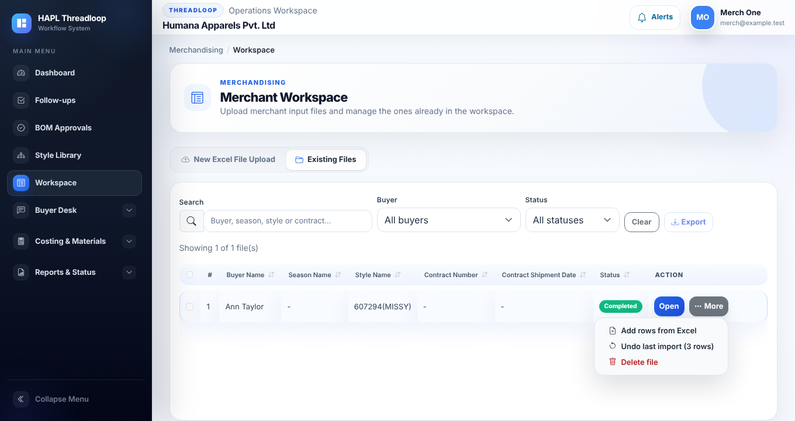
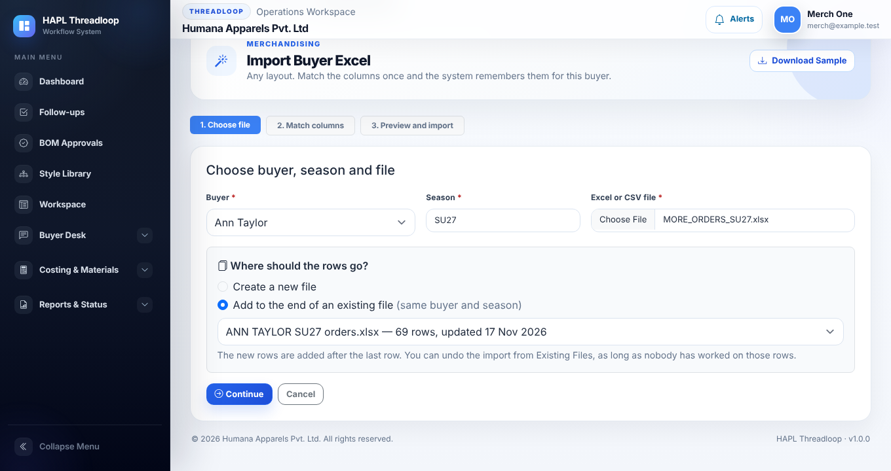
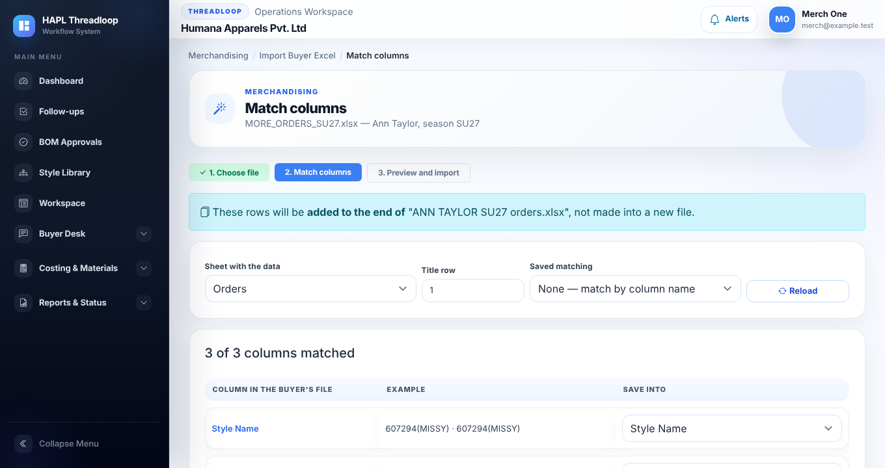
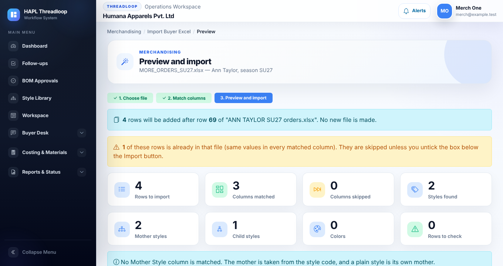
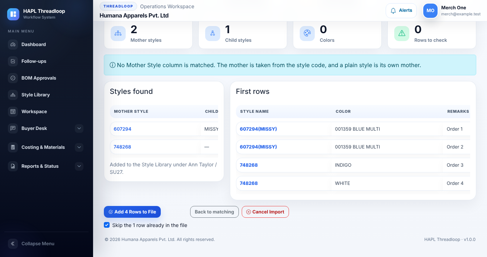
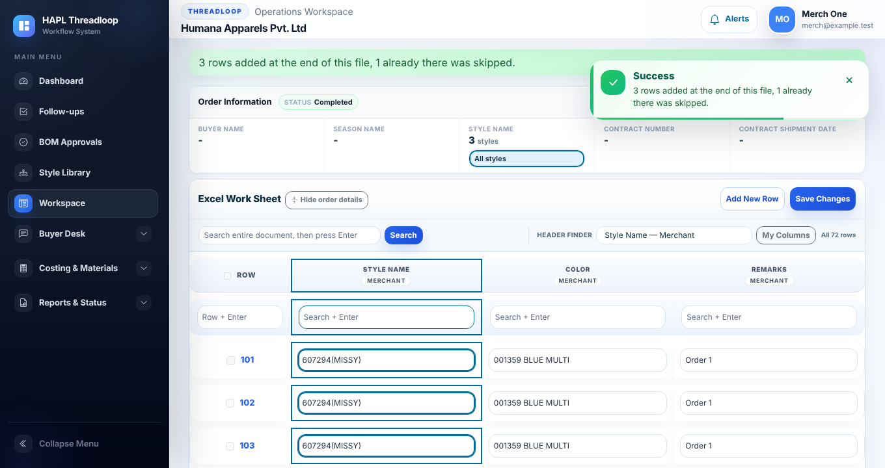

# Add more orders to an existing file (short guide)

Use this when a buyer sends more order lines for a season that already has a file. The new Excel rows go to the **end of the existing file**. No new file is made.

You can use it for your own buyers only. The file must be for the **same buyer and season** and must not be locked.

## 1. Open the file's menu
**Workspace, Existing Files**, press **More** on the file, then **Add rows from Excel**.

## 2. Choose your Excel
Buyer and season are already filled. Choose your Excel file. Keep **Add to the end of an existing file** selected (pick the file if there are several). Press **Continue**.

## 3. Match the columns
Same as a normal import. The blue note confirms the rows will be added to the end of your file. If the columns match by name or by the saved matching, you go straight to the preview.

## 4. Check the preview and add
The top says how many rows will be added after which row. Rows already in the file (same values in every matched column) are counted in yellow and **skipped** while **Skip the N rows already in the file** is ticked. Press **Add N Rows to File**.

## 5. Done
You land on the file. The new rows are at the end. Formulas, BOM and Style Library are updated, and other departments are notified.

## 6. Wrong file? Undo
**Workspace, Existing Files, More, Undo last import**. It removes that block of rows. It works only for the **latest** import, while **nobody has edited those rows** or used them (PO, payment request, store receiving). Use Undo for a mistake: imported rows cannot be deleted one by one.

(The same **More** menu as step 1 shows **Undo last import (N rows)**.)

## Good to know
- **No Add rows from Excel under More?** The file is locked, belongs to another buyer, has no buyer/season, or your account may not upload BOM files.
- **File not in the list?** Different buyer or season. Check the spelling, SU27 and SP27 are different.
- Only **new rows** are added. Old rows are not changed from the new Excel.
- Two files cannot be joined into one with this feature.
