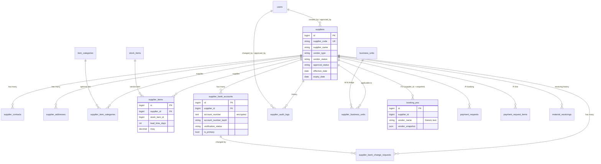
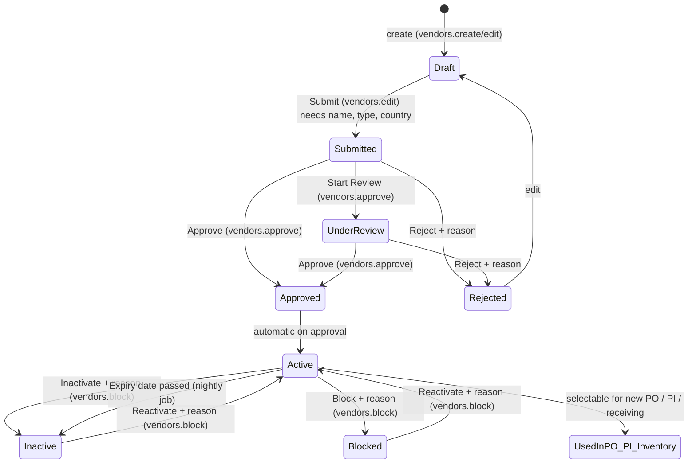
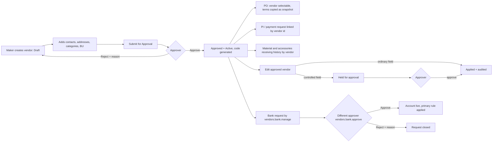

# 21 — Vendor Master: design, workflow, integration

The Vendor Master is the **existing `suppliers` table** (Admin > Vendors, Merchant > Vendors, PO booking).
It was extended in place; no second vendor table exists. Everything is additive and nullable, so
vendors already saved keep working. Store's own `general_stock_suppliers` list is a separate master
and was not changed.

## 1. What was found (Phase 1)

| Area | Before |
|---|---|
| Table | `suppliers` (code, name, legal name, one contact, one address, item type, incoterm, ship mode, tolerance, 6 bank columns in clear text, `is_active`, soft deletes) |
| Screens | Admin > Vendors (`SupplierController`), Merchant > Vendors (`VendorEntryController`) with 19-column Excel import/export |
| Use in transactions | `booking_pos.vendor_name` (text), `BookingController::findSupplier` (name match, defaults for tolerance), `payment_requests(.items).supplier_name` + `pi_number` (text), `material_receivings.supplier_name` (text) |
| Gaps | no approval, status, expiry, BU, multiple contacts/addresses/banks, audit, bank protection (plain text, no approval), no vendor id on transactions |

## 2. Schema (Phase 2)

### `suppliers` (main table) — new columns

| Requested field | Column |
|---|---|
| Vendor ID / Code (unique) | `id` / `supplier_code` (unique; `VND-nnnnn` generated on approval when empty) |
| Vendor Name, Legal Name | `supplier_name`, `legal_name` |
| Vendor Type | `vendor_type` local/foreign |
| Vendor Category | `vendor_category` |
| Vendor Status | `vendor_status` active/inactive/blocked (kept in step with legacy `is_active`) |
| Approval Status | `approval_status` draft/submitted/under_review/approved/rejected (Pending = submitted or under_review) |
| TIN, VAT/BIN, Business Reg. | `tin`, `vat_bin_number`, `business_reg_number` |
| Country | `country` (existing) |
| Defaults | `default_currency`, `default_payment_terms`, `incoterm`, `ship_mode`, `tolerance_percent` (existing), `lead_time_days`, `moq` |
| Effective / Expiry | `effective_date`, `expiry_date` |
| BU applicability | table `supplier_business_units` |
| External ERP code | `external_erp_code` |
| Remarks | `remarks` (+ `status_reason`) |
| Authorship | `created_by`, `updated_by`, `approved_by`, `submitted_at`, `approved_at`, `created_at`, `updated_at`, `deleted_at` |

Legacy columns (`contact_person`, `email`, `phone`, `address`, `city`, `item_type`) stay and are kept equal to
the primary contact / address / first category, so old screens, exports and PO documents keep working.
Legacy `bank_*` columns are no longer written; existing bank data was copied (encrypted) into `supplier_bank_accounts`
and the plain-text account / routing numbers were cleared by the migration.

### New tables

| Table | Purpose | Key constraints / indexes |
|---|---|---|
| `business_units` | company / BU master (`code` unique, `name`) | unique `code` |
| `supplier_business_units` | vendor ↔ BU (many-to-many) with status, effective, expiry | unique (`supplier_id`,`business_unit_id`) |
| `supplier_contacts` | many contacts, `is_primary`, `contact_type`, `status` | idx (`supplier_id`,`is_primary`) |
| `supplier_addresses` | registered / office / factory / warehouse, `is_primary` | idx (`supplier_id`,`is_primary`) |
| `supplier_item_categories` | categories supplied; `item_category_id` (optional FK-by-value to `item_categories`), `item_type` material/accessory/general, own `lead_time_days`, `moq`, `tolerance_percent` | unique (`supplier_id`,`category_name`,`item_type`) |
| `supplier_items` | vendor ↔ item (`stock_item_id` → `stock_items`) with item MOQ / lead time / preferred; several vendors per item allowed | idx (`supplier_id`,`status`), idx `stock_item_id` |
| `supplier_bank_accounts` | bank accounts; `account_number`, `routing_number`, `iban` **encrypted**; `account_number_last4`; `account_number_hash` (HMAC, duplicate check); `verification_status`; `approved_by/at` | idx hash, idx (`supplier_id`,`is_primary`) |
| `supplier_bank_change_requests` | maker-checker queue: `action` create/update/deactivate, encrypted `payload`, masked `summary`, `status`, requester / reviewer | idx (`supplier_id`,`status`) |
| `supplier_audit_logs` | field-level history: entity, action, field, old/new, approval status, changed by, approved by/at, remarks | idx (`supplier_id`,`created_at`) |

Transaction links (nullable, additive):

| Table | Added |
|---|---|
| `booking_pos` (PO) | `supplier_id`, `vendor_snapshot` (json, no bank data), `incoterm`, `ship_mode`, `tolerance_percent` |
| `payment_requests`, `payment_request_items` (PI) | `supplier_id` |
| `material_receivings` | `supplier_id` |

`supplier_id` on PI / receiving rows is filled automatically on create by an exact, case-insensitive name/code match
(`LinksVendor`), and back-filled for existing rows only when exactly one vendor has that name. The `supplier_name` text
on every row remains the historical value.

## 3. ER diagram (Phase 6)

Primary keys: every table `id`. Foreign keys with cascade: all `supplier_*` children → `suppliers.id`;
`supplier_business_units.business_unit_id` → `business_units.id`. Plain indexed ids (no DB constraint, so history
survives deletion): `booking_pos.supplier_id`, `payment_requests(.items).supplier_id`, `material_receivings.supplier_id`,
`supplier_items.stock_item_id`, `supplier_item_categories.item_category_id`, audit user ids.
One-to-many: vendor → contacts / addresses / categories / items / banks / requests / audit logs / POs / PIs / receivings.
Many-to-many: vendor ↔ business unit (`supplier_business_units`); vendor ↔ stock item (`supplier_items`).

## 4. Business rules (Phase 3) and where they live

| # | Rule | Implemented in |
|---|---|---|
| 1 | Code unique | DB unique + `SupplierController::validatedData`, import (file + DB) |
| 2 | Name mandatory | validation, import |
| 3-6 | Blocked / inactive / unapproved / expired / not-yet-effective vendors unusable for NEW transactions | `Supplier::scopeSelectable()`, `Supplier::unusableReason()`; enforced when a PO is generated (`BookingController::generateBookingForRow`, 422 with the reason) and by `findSupplier` |
| 7 | Applicable to the BU | `scopeSelectable($buId)`, `appliesToBusinessUnit()` (no BU rows = all units) |
| 8-9 | Multiple contacts / addresses / categories / banks, primary configurable | child tables, `VendorMasterController` (one primary enforced) |
| 10 | History preserved | PO `vendor_snapshot` + own incoterm / ship mode / tolerance; PI / receiving keep `supplier_name` text; soft deletes; audit log |
| – | Defaults vs overrides | vendor `incoterm`/`ship_mode`/`tolerance_percent` are defaults copied onto the PO; the PO values are the PO's own and editable; item > category > vendor for lead time / MOQ (`VendorMaster::termsFor`) |
| – | A vendor not in the master (free text in sheets) still works | PO generation only blocks a vendor that **is** in the master and unusable |

## 5. Workflow (Phase 4 and 7)

### Stage by stage

1. **New vendor creation** – Admin / Merchant "Add Vendor" or Excel import → Draft + inactive, audited (`created`/`imported`).
2. **Submission** – `Submit for Approval`; blocked until name, type, country exist.
3. **Approval** – Start Review → Approve (activates, generates code if blank) or Reject (reason required).
4. **Activation** – automatic on approval (unless the vendor is blocked).
5. **Modification** – ordinary fields apply at once with field-level audit; controlled fields (name, legal name, code, type, TIN, VAT/BIN, reg. no., currency, payment terms, ERP code) on an approved vendor are held as `modification_requested` until an approver decides. An approver's own edits apply directly.
6. **Bank account approval** – every create / update / deactivate is a `supplier_bank_change_requests` row; a *different* user with `vendors.bank.approve` decides; the requester can cancel a pending request. Numbers are encrypted, shown masked, never logged.
7. **Block / inactivate / reactivate** – reason mandatory, audited. Expiry sets Inactive nightly (`Schedule` 00:30 Asia/Dhaka).
8. **Vendor in PO** – PO generation resolves the vendor from the sheet's Vendor Name (exact match); unusable → 422 with reason; usable → `supplier_id`, `vendor_snapshot`, `incoterm`, `ship_mode`, `tolerance_percent` stored on the PO; users may still override on the PO.
9. **Vendor in PI booking** – `payment_requests` / `payment_request_items` get `supplier_id` (auto link by name); several PIs per vendor; `po_no`, currency, terms and shipping stay on the row as entered.
10. **Inventory** – `supplier_items` links vendor ↔ stock item (material or accessory) with item MOQ / lead time; several suppliers per item; receiving history by vendor through `material_receivings.supplier_id`.

## 6. Integration notes (Phase 5)

* **PO** – approved + active + in-date + BU-applicable vendors only; defaults loaded via `VendorMaster::termsFor($vendor, $itemCategory, $stockItemId)` (item > category > vendor); snapshot never rewritten by vendor edits; revisions keep the original `supplier_id`.
* **PI booking** – vendor id on header and lines, text snapshot kept; the PO↔PI link stays `po_no` + `pi_number` as today.
* **Inventory** – `supplier_items` (item-level) and `supplier_item_categories` (category-level) hold supplier MOQ / lead time; purchasing and receiving history by vendor is a query on `supplier_id`.
* **Not changed on purpose**: Store's `general_stock_suppliers` master (General Stock purchasing) and the free-text vendor flow in the order sheets.

## 7. Roles and permissions

Existing permissions `vendors.view/create/edit/delete` are unchanged. Added (migration `2026_11_18_000002`): 

| Permission | Allows |
|---|---|
| `vendors.view` | open the vendor profile (read), see contacts / addresses / categories / audit (non-bank) |
| `vendors.create` / `vendors.edit` | create drafts, edit details, manage contacts / addresses / categories / items / BU, submit for approval |
| `vendors.approve` | start review, approve, reject, decide held modifications |
| `vendors.block` | block, inactivate, reactivate |
| `vendors.bank.view` | see bank accounts (masked) and bank audit rows; export masked Bank Accounts sheet |
| `vendors.bank.manage` | request a bank account add / change / deactivation; import bank rows (as requests) |
| `vendors.bank.approve` | approve / reject bank requests (never your own) |
| `vendors.delete` | (existing) delete – Admin screen only |

| Action | Admin | Merchant | Supply Chain | Commercial | Accounts | Store |
|---|---|---|---|---|---|---|
| View profile | ✔ | ✔ (role) | ✔ `vendors.view` | by grant | by grant | by grant |
| Create / edit / submit | ✔ | ✔ (role) | by grant | – | – | – |
| Approve / reject | ✔ | by grant | by grant | – | – | – |
| Block / inactivate | ✔ | by grant | by grant | – | – | – |
| Bank view (masked) | ✔ | – | ✔ (seeded) | ✔ (seeded) | ✔ (seeded) | – |
| Bank request | ✔ | – | – | – | ✔ (seeded) | – |
| Bank approve | ✔ | – | by grant | – | by grant | – |

"Seeded" = granted by the migration to the role if it exists; everything else is assigned on **Admin > Roles**. The admin role passes
every check (`Gate::before`). Maker-checker on bank accounts is enforced even for admin: the requester cannot approve.

## 8. Excel import / export (Phase 8)

Workbook sheets: **Vendors** (one row per vendor), **Contacts**, **Addresses**, **Item Categories**, **Bank Accounts**, each child row
starting with the Vendor Name (+ an Instructions sheet in the template). Sheets are recognised by header row. The old 19-column
single-sheet file is still accepted (its contact / address / item type / bank columns become the first child rows).
The whole file is validated first (required fields, unique codes in file and DB, types, dates, ranges, orphan child rows, duplicate bank
numbers) and nothing is saved if any row fails; existing vendors are skipped, never duplicated or overwritten; one transaction;
summary returned. Bank rows become pending requests, and only for users with `vendors.bank.manage`. Export masks account numbers
and omits routing / IBAN; the Bank Accounts sheet needs `vendors.bank.view`.

## 9. Migration and rollout notes

* `2026_11_18_000001` — schema + back-fill: every existing vendor becomes **Approved**, status from `is_active`, so purchasing carries on unchanged. Existing contact / address / item type / bank data is copied into the child tables; plain-text account and routing numbers are then cleared from `suppliers` (the data lives encrypted in `supplier_bank_accounts`). `down()` restores structure only; it cannot restore cleared numbers.
* `2026_11_18_000002` — permissions. `2026_11_18_000003` — vendor id on PI / receiving + safe back-fill.
* Needs the application `APP_KEY` to be stable (bank numbers are encrypted with it). Changing the key makes stored bank numbers unreadable.
* Behaviour changes users will notice: new vendors are Drafts until approved; merchants no longer type bank numbers directly (an accounts user requests, another approves); vendors learned from PO documents are created as unapproved drafts.
* Not built (stated openly): an on-screen company / BU master editor (rows are added by seeding or tinker; a BU-less vendor works for all units), screens to edit `supplier_items` beyond add/remove, applying vendor terms inside the PO edit form beyond the stored snapshot, and a PO-level override audit.
